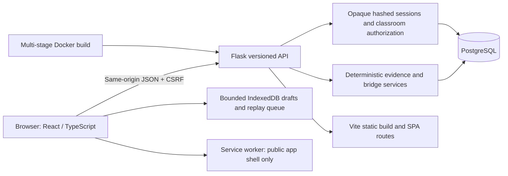
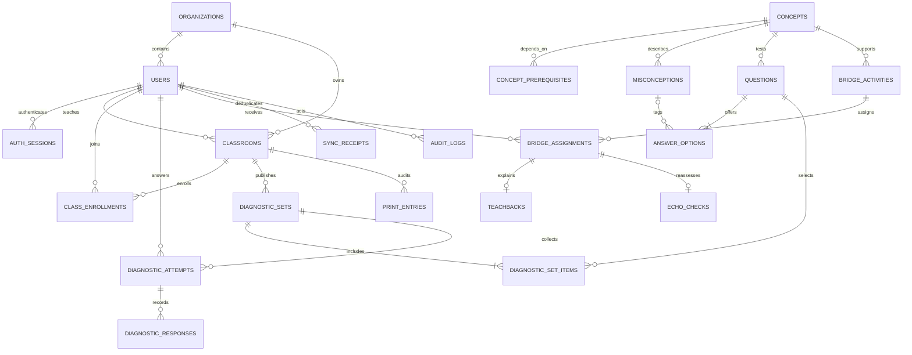

# Architecture

One production web service serves both API and static files. No production CORS is required. Gunicorn uses one worker with four threads, matching the single-instance demo and in-process login limiter. Startup migrations use a PostgreSQL advisory lock. Larger deployments should move migration execution into a controlled release step and provide a shared limiter backend; they are outside this deployment's sizing assumptions.

## Relational model

For this slice a diagnostic set is its classroom assignment; one set has one classroom, and each learner has at most one immutable attempt per set. Reassessment uses a newly authored set. There is no separate scheduling table for repeated diagnostic assignments. Content versions are immutable question records. Teachers can adapt a bridge into a newly approved record without changing an already assigned activity.

## Security boundaries

Sessions use 48-byte random opaque cookies, SHA-256 server-side token hashes, an eight-hour expiry and explicit revocation. Passwords use Argon2id. Production cookies require HTTPS and are HttpOnly/SameSite=Lax; CSRF tokens are separate cookies bound to server session hashes. Unauthenticated login CSRF tokens are signed and expire. All mutations require a matching header. Unknown credentials receive a common message; login is limited to ten attempts per minute per IP.

Teacher access requires classroom ownership and organization equality. Student assignments require ownership and enrollment. Teachers can author only their organization's content; students never receive active answer keys. Admin routes expose aggregate health and bounded audit history. SVG markup is never accepted; bounded numeric drawing strokes render as React polylines. Text is escaped by React. JSON bodies are limited to 128 KiB. Production rejects SQLite or weak secrets. Private API responses carry `Cache-Control: no-store`.

Offline replay permits only student answer, finish, completion and teach-back operations. Every item passes the normal ownership and state checks. Receipt uniqueness is `(user_id, client_mutation_id)`, fingerprints reject key reuse with different payloads, and valid items commit independently. Conflicts stay visible on the device for review. Teacher reviews and grades cannot be replayed offline.
